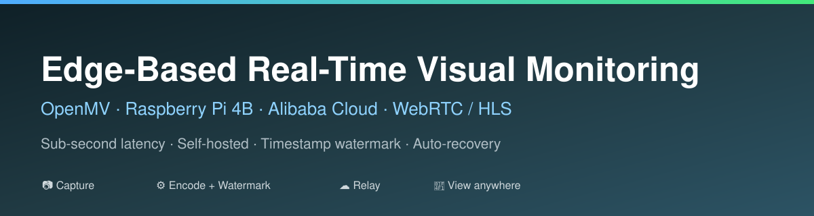
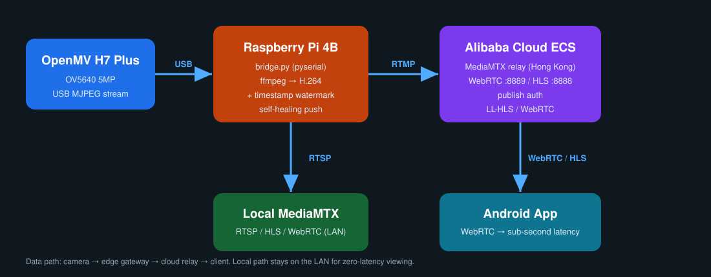

<div align="center">



# 边缘实时视觉监控系统
### Edge-Based Lightweight Real-Time Visual Perception & Monitoring System

**OpenMV · 树莓派 4B · 阿里云 · WebRTC / HLS —— 手机端亚秒级远程监控**

[](https://github.com/leisure-Y101/Edge-Based-Lightweight-Real-Time-Visual-Perception-Semantic-Understanding-System/stargazers)
[](https://github.com/leisure-Y101/Edge-Based-Lightweight-Real-Time-Visual-Perception-Semantic-Understanding-System/network/members)
[](LICENSE)
[](https://github.com/leisure-Y101/Edge-Based-Lightweight-Real-Time-Visual-Perception-Semantic-Understanding-System/commits/main)


**中文** · [English](#-english)

</div>

---

> 一套**低成本、可自托管**的端到端视频监控方案：摄像头采集 → 边缘编码 → 云端中转 → 手机 App 观看。
> 面向 10 人以内的小规模场景，开箱即用、开机自启、掉线自愈。

---

## ✨ 特性一览

| | 特性 | 说明 |
|---|---|---|
| 🎯 | **亚秒级延迟** | 云端 WebRTC 分发，手机端延迟 < 1s |
| 🕒 | **真实时间水印** | ffmpeg `drawtext` 烧进视频，所有人时间一致 |
| 🔌 | **USB 直连采集** | OpenMV 经 USB 发送 MJPEG，无需网络摄像头驱动 |
| 🧩 | **双路分发** | 局域网（本地 MediaMTX）+ 公网（云端中转） |
| ♻️ | **自愈推流** | 每个推流目标独立线程，卡死/掉线自动重连 |
| 🚀 | **开机自启** | 树莓派与云端均由 systemd 托管 |
| ☁️ | **穿透 CGNAT** | 云服务器中转，不依赖公网 IPv4 |
| 📱 | **一键分发** | 打包 APK，装上即看，无需配置 |
| 🔐 | **推流鉴权** | 仅持密码者可推流，防止串流 |

---

## 🏗️ 系统架构

<div align="center">

</div>

```
                        USB (MJPEG over CDC)
   [OpenMV Cam H7 Plus] ──────────────────────┐
                                               ▼
                                        [树莓派 4B]
                                    bridge.py (pyserial)
                                               │
                                     ffmpeg: 解码JPEG → H.264
                                       + drawtext 时间水印
                                               │
                        ┌──────────────────────┴───────────────────────┐
                        ▼                                               ▼
         [本地 MediaMTX]                                    RTMP 推流 (经公网)
       RTSP :8554 / HLS :8888                                       │
       WebRTC :8889（局域网）                                        ▼
                                                          [阿里云 ECS · 香港]
                                                             MediaMTX (中转)
                                                        ┌────────────┴────────────┐
                                                        ▼                         ▼
                                                 WebRTC :8889                 HLS :8888
                                                 （Android App，<1s）        （浏览器 / VLC）
```

- **就近观看**：局域网内直接看树莓派的本地流，延迟最低。
- **远程观看**：经云端中转，任何网络（含 4G/5G）都能看。

---

## 📸 演示 / Demo

> 截图与演示视频放在 `docs/` 目录下，替换为你的实拍即可。

| 手机 App（WebRTC） | 局域网 HLS |
|---|---|
| _docs/screenshot-app.png_ | _docs/screenshot-hls.png_ |

**效果**：640×480 @ 25fps，约 1.2 Mbps，画面左上角带真实时间水印，手机端延迟 < 1s。

---

## 📦 目录结构

```
.
├── openmv/main.py            # OpenMV 端：采集 + JPEG + USB 发送
├── pi/
│   ├── bridge.py             # 树莓派端：串口 → ffmpeg → 本地+云端（自愈）
│   ├── mediamtx.yml          # 本地 MediaMTX 配置（可选）
│   ├── mediamtx.service      # 本地 MediaMTX 开机自启
│   └── bridge.service        # 桥接服务开机自启
├── cloud/
│   ├── mediamtx.yml          # 云端 MediaMTX 配置（鉴权 / LL-HLS / WebRTC）
│   └── mediamtx.service      # 云端 MediaMTX 开机自启
├── app/                      # Flutter 安卓工程（WebRTC WebView 播放器）
└── docs/                     # 图与截图
```

---

## 🧰 硬件清单

| 设备 | 型号 / 规格 | 用途 |
|---|---|---|
| 摄像头 | **OpenMV Cam H7 Plus**（STM32H743 + OV5640 5MP） | 采集、JPEG 压缩 |
| 主控/网关 | **Raspberry Pi 4 Model B，8GB** | 读取、编码、推流、本地分发 |
| 存储 | microSD 16GB+（长期运行建议 USB 启动） | 系统盘 |
| 电源 | **5V/3A 及以上** 优质电源（关键！） | 树莓派供电 |
| 线材 | 优质短 USB 线，**直插主板**，避免劣质 Hub | 摄像头连接 |
| 云端 | 阿里云 ECS（香港）2 vCPU / 2 GiB | 公网中转 |
| 客户端 | 任意 Android 手机 | 观看 |

---

## 🛠️ 软件栈

| 环节 | 软件 / 技术 |
|---|---|
| 摄像头 | OpenMV IDE + MicroPython（`sensor` / `img.compress` / `USB_VCP`） |
| 树莓派系统 | Debian 13 (trixie) 64-bit |
| 串口 / 编码 | Python 3 + `pyserial` · `ffmpeg`（libx264 ultrafast zerolatency） |
| 时间水印 | ffmpeg `drawtext` |
| 流媒体 | **MediaMTX v1.21.2**（RTSP / RTMP / HLS / WebRTC） |
| 服务托管 | systemd |
| 云端 | 阿里云 ECS · Ubuntu 22.04 LTS |
| 手机端 | Flutter 3.44 + `webview_flutter` |

---

## 🚀 快速开始

### 1) OpenMV 端

安装 [OpenMV IDE](https://openmv.io/pages/download)，连接摄像头（识别为 **OpenMV Cam H7 Plus**），把 `openmv/main.py` 保存为板载 `main.py`：

```python
import sensor
from pyb import USB_VCP

usb = USB_VCP()
sensor.reset()
sensor.set_pixformat(sensor.RGB565)
sensor.set_framesize(sensor.VGA)      # 640x480
sensor.skip_frames(time=2000)

while True:
    jpg = sensor.snapshot().compress(quality=60)
    usb.send(jpg)
```

### 2) 树莓派端

```bash
sudo apt install -y ffmpeg python3-serial

# MediaMTX (aarch64)
curl -L -o mediamtx.tar.gz \
  https://github.com/bluenviron/mediamtx/releases/download/v1.21.2/mediamtx_v1.21.2_linux_arm64.tar.gz
mkdir -p ~/mediamtx && tar -xzf mediamtx.tar.gz -C ~/mediamtx

# 桥接（读取串口 → 编码 → 本地+云端）
python3 ~/monitor/bridge.py /dev/ttyACM0 rtsp://127.0.0.1:8554/cam \
  "rtmp://<云端IP>:1935/cam?user=pusher&pass=<推流密码>"
```

> 完整 `bridge.py`（含时间水印与自愈逻辑）见 [`pi/bridge.py`](pi/bridge.py)。

### 3) 阿里云服务器端

```bash
curl -L -o mediamtx.tar.gz \
  https://github.com/bluenviron/mediamtx/releases/download/v1.21.2/mediamtx_v1.21.2_linux_amd64.tar.gz
mkdir -p /root/mediamtx && tar -xzf mediamtx.tar.gz -C /root/mediamtx
# 使用 cloud/mediamtx.yml，然后 systemctl enable --now mediamtx
```

**安全组放行**（阿里云控制台 → 安全组 → 入方向）：

| 协议 | 端口 | 用途 |
|---|---|---|
| 自定义 TCP | `1935/8889` | RTMP 推流 + HLS + WebRTC 信令 |
| 自定义 UDP | `8189/8189` | WebRTC 媒体（低延迟必需） |

### 4) 安卓 App

```bash
cd app
flutter pub get
flutter build apk --release
# 产物：build/app/outputs/flutter-apk/app-release.apk（发给朋友直接安装）
```

---

## 🌐 网络诊断与发现（CGNAT / IPv6）

- 宽带 **IPv4 为 CGNAT**（WAN 口 `100.64.x.x`）→ **无法端口映射**；
- 但网关下发 **公网 IPv6**（`2409:.../64`）；
- 手机热点网络同样处于 CGNAT。

**结论**：选用「**云服务器中转**」作为外网入口，稳定、通用、不依赖运营商。
（备选：IPv6 + DDNS 直连、Tailscale 异地组网。）

---

## 🧠 关键技术

1. **USB MJPEG 直通**：OpenMV 连续发送 JPEG，树莓派 `ffmpeg -f mjpeg -i -` 解析。
2. **时间水印**：`drawtext` + `%{localtime}`，烧进视频；因转义限制时间用横杠 `%Y-%m-%d %H-%M-%S`。
3. **双目标 + 自愈**：每目标独立线程 + 队列，卡死独立重启；含「启动宽限期」避免建连误杀。
4. **云端鉴权**：`authInternalUsers` 限制推流，观看开放。
5. **低延迟观看**：云端同时提供 **WebRTC（<1s）** 与 **LL-HLS（~2s）**。
6. **开机自启**：systemd `enable`，断电恢复自动拉起。

---

## 👀 使用与观看

设云端公网 IP 为 `<IP>`：

| 方式 | 地址 | 延迟 |
|---|---|---|
| **WebRTC（推荐）** | `http://<IP>:8889/cam` | **< 1s** |
| HLS | `http://<IP>:8888/cam/index.m3u8` | ~2s |
| RTSP | `rtsp://<IP>:8554/cam` | 低 |
| 局域网 | `http://<树莓派IP>:8889/cam` | 近零 |

---

## 💰 成本

| 项目 | 费用 |
|---|---|
| OpenMV / 树莓派 | 一次性硬件 |
| 阿里云 ECS | 试用期免费；之后约 ¥10~30/月 |

---

## 🧯 已知问题 / 踩坑

1. **OpenMV USB 掉线/复位**：多为**供电 / USB Hub / 线材**问题；建议优质电源、直插主板、好线材。
2. **桥接误杀**：网络变慢时 ffmpeg 建连慢，曾被"卡死重启"误判 → 已加**启动宽限期**。
3. **RTMP 鉴权格式**：MediaMTX 需用 `?user=..&pass=..`，不能用 `user:pass@`。
4. **HLS 延迟**：默认切片延迟高，改 **LL-HLS** 后大幅下降；极致低延迟请用 **WebRTC**。
5. **HLS 首访 302**：MediaMTX 有 cookie 校验，浏览器/播放器自动处理。

---

## ⭐ 支持 / Support

如果这个项目对你有帮助，欢迎点个 **Star ⭐** 支持一下，也欢迎提 Issue / PR！

[](https://star-history.com/#leisure-Y101/Edge-Based-Lightweight-Real-Time-Visual-Perception-Semantic-Understanding-System&Date)

---

## 🌍 English

<div align="center"><b>Edge-Based Lightweight Real-Time Visual Perception & Monitoring System</b></div>

A low-cost, **self-hosted** end-to-end video monitoring stack:
**OpenMV camera → Raspberry Pi (edge encoding) → Alibaba Cloud relay → Android app.**

- **Sub-second latency** over WebRTC; HLS fallback for maximum compatibility
- **Timestamp watermark** baked into the video by `ffmpeg drawtext`
- **Dual-target push** (LAN + cloud) with **per-target self-healing**
- **Bypasses CGNAT** using a public cloud relay (no port forwarding needed)
- Ships with a **Flutter Android app** (WebRTC player) you can build and share as an APK

**Tech:** OpenMV MicroPython · Python/pyserial · ffmpeg · [MediaMTX](https://github.com/bluenviron/mediamtx) · systemd · Flutter · Alibaba Cloud ECS.

> If this project helps you, please consider giving it a ⭐ — thank you!

---

## 📄 License

[MIT](LICENSE) © 2026
